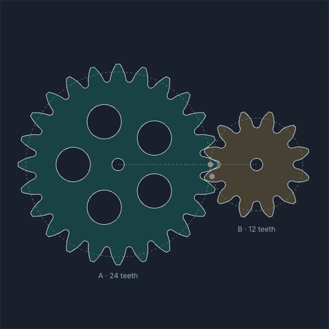
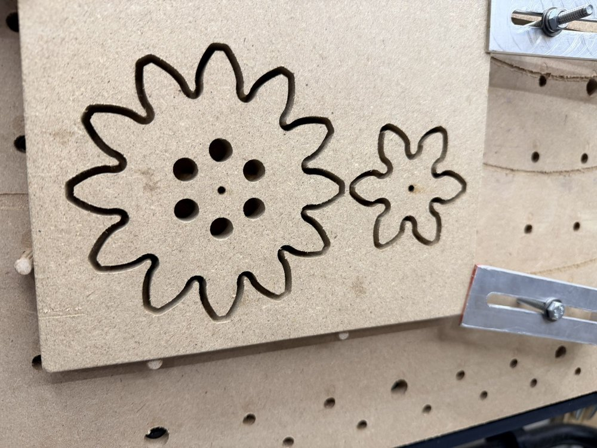
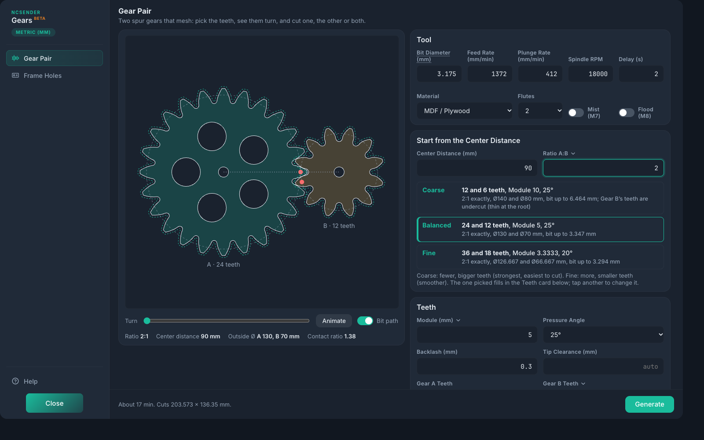
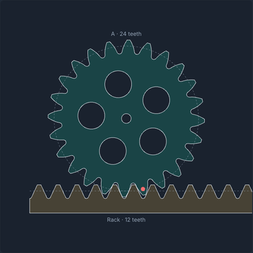
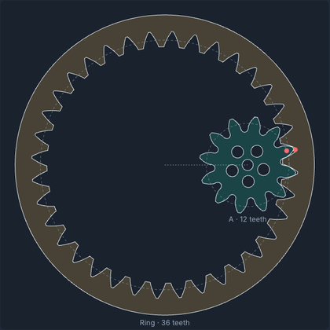
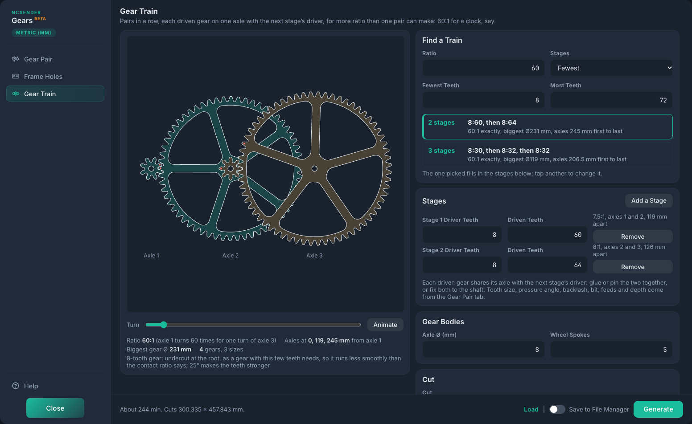

# Gears

**Real, working gears from your CNC in a few minutes.** Tell Gears how far apart the axles are and
the ratio you want. It picks the teeth, shows them turning, and writes the G-code for
[ncSender](https://github.com/siganberg/ncSender). Press **Generate**, cut, and they mesh.

<p align="center"></p>

Great for toys, clocks, winches, marble machines and gear-ratio demos, in plywood, MDF, hardwood,
HDPE, acrylic or aluminum.

<p align="center"></p>
<p align="center"><em>The first pair cut with Gears: 12 and 6 teeth in MDF, straight off the machine. They mesh.</em></p>

## Three steps

1. **Pick your bit.** Choose it from the tool table or type its size. Gears only offers teeth that
   bit can cut.
2. **Type the center distance and the ratio.** Tap one of the pairs that fit: coarse, balanced or
   fine.
3. **Press Generate.** Both gears come out in one program, nested close together to save stock.



## Racks and ring gears too

Switch Gear B to a **rack** for straight-line motion, or to a **ring** for planetary gears and
compact reductions.

<p align="center">
  
  
</p>

Inspired by Matthias Wandel's gear work at [woodgears.ca](https://woodgears.ca); for paper templates
to cut on a bandsaw, use his (more complete) [gear template generator](https://woodgears.ca/gear/).
Gears isn't affiliated with him: its geometry is the standard involute, written fresh.

## Gear trains

For more ratio than one pair makes, the **Gear Train** tab chains pairs: each driven gear shares an axle with the
next stage's driver. Type the ratio (60 for 60:1, a clock's seconds to minutes) and it finds the smallest trains
that make it, exactly when whole teeth allow: 60:1 is 8:60 then 8:64. It cuts the whole train in one program,
one stage, one gear, or the frame's axle holes, and warns when a gear would reach another axle's shaft.



Drag the axles in the picture to fold the train into a compact frame, or press **Fold Compact**; the frame's
holes follow. Not sure what you need? **Start from a Preset**: a clock's seconds to minutes (60:1), its minutes
to hours (12:1, with the hour wheel coming back onto the minute hand's shaft, as on a real dial), a slow crank,
or a spinner. Help explains the ideas plainly.

## What to make

Wooden clocks and automata; replacement gears for a hand-turned toy, game or model (count the teeth and measure
across the tips: module = diameter in mm ÷ (teeth + 2)); indexing wheels for dividing a circle on the lathe or drill
press; fine adjusters and camera sliders (rack and pinion); turntables and displays; planetary demonstrators;
marble machines and kinetic art. Not for anything that could hurt someone if a tooth broke: see the fine print.

## Everything it does

- **A gear pair** that meshes: teeth for Gear A and Gear B, one tooth size (**Module**, **Diametral
  Pitch** or **Circular Pitch**, from the menu on its label), a **Pressure Angle** (14.5°, 20° or 25°).
  The preview shows the pair at the center distance; **Turn** rolls them through mesh and **Animate**
  runs them. The ratio, center distance, outside diameters and contact ratio are listed under it.
- **True involute teeth, cut as a rack cuts them.** The flanks are within 0.001 mm of the exact
  involute, and gears with few teeth get the undercut the mating tooth needs, so any two gears of the
  same tooth size and pressure angle mesh.
- **Teeth your bit can cut.** The bottom of each tooth space is rounded to at least the bit's radius,
  so a round end mill reaches all of it. That sets the smallest teeth a bit can cut, which the Teeth
  card shows with a link to use it (a 1/8" bit: about 3.2 mm module, Diametral Pitch 7; a 1/4" bit
  twice that). Teeth too small for the bit are refused with what to change.
- **Clearances for real materials.** **Backlash** (play between the teeth, 0.3 mm by default) and
  **Tip Clearance** (room at the root: blank is a quarter module, or more when the bit's rounding at
  the root needs it so the other gear's tips clear it; a typed one under that is refused).
- **Gear bodies:** a **Bore** for the axle: round; **Hex** (sized across the flats, such as 12.7 mm
  for a 1/2" hex shaft); **D** (round with one flat, for a D shaft such as a motor's, sized by
  **Across the Flat**); or **Keyed** (round with a keyway, **Key Width** at least the bit's and
  **Key Depth** past the bore). Each sharp corner gets a small notch so a sharp-cornered shaft or key
  fits. And **Lightening Holes** in a ring between the hub and the teeth, or **Spokes**: straight
  spokes from the hub to the rim (**Spoke Width**, blank for automatic) with windows between them,
  their corners rounded past the bit. **Holes and Windows:** **Cut Out** (the default) cuts round their edge
  only, with two small tabs holding the piece inside to knock out after (on a clock train's spoked wheels, about
  20 minutes instead of an hour); **Clear Out** cuts all the wood inside away from the middle, nothing to knock
  out. Cut Out needs Holding Tabs on, and small holes are cleared anyway. Bores are always cleared from the
  middle, so nothing comes loose.
- **Cutting:** each gear's holes, then its teeth from outside a bit radius out; depth passes, each
  ramped down along the path at 5° or less (Z never faster than the Plunge Rate), and **Holding Tabs**
  on tooth tips, where they're easy to sand off. Conventional or Climb.
- **Both gears in one program**, nested to save stock: Gear B turned so its teeth face Gear A's spaces, **Gap Between**
  apart where they come closest: at least the bit's diameter and a tenth (blank), or more for a screw or clamp, or
  sturdier tabs. Or either one alone; X0 Y0 at the gear's center or the front-left corner of the cuts.
- **Rack and pinion:** Gear B's menu can make it a straight **rack** with that many teeth, Gear A
  its pinion: the same tooth size, pressure angle, backlash and bit-rounded roots, on a bar **Rack
  Height** deep under the teeth, with screw holes along it (Gear B's Bore and Holes fields become
  the screw holes' size and count). It's cut from outside with tabs on its flat bottom edge. The
  preview rolls the pinion along it, and the facts give the rack's travel a turn and where to mount
  it: its pitch line and bottom edge from the pinion's axle.
- **Ring gears:** Gear B's menu can make it a **ring** (an internal gear) with its teeth inside and
  Gear A its pinion turning inside it, the same way: for planetary gears and compact reductions. The
  ring needs at least 12 more teeth than the pinion at 20° (10 at 25°, 16 at 14.5°), or their tips
  collide. Its teeth are shaped as your bit cuts them from inside, a little short so they clear the
  pinion's root rounding; it has a **Rim Width** outside its teeth with screw holes (Gear B's Bore and
  Holes fields). It's cut from inside with tabs on its tooth tips, so the middle stays put until you
  cut them, then round its outside.
- **Ratio:** Gear B's field can take the ratio A:B instead of its teeth (3 for 3:1); Gear B's teeth
  are worked out to the nearest whole tooth and the real ratio shown.
- **Center Distance:** blank is the gears' own. Type the distance the axles must be and either
  spread the gears to it (a little wider: more backlash, shown with the contact ratio; too wide or
  too close is refused with the range that works) or press **Fit Tooth Size** to make the teeth mesh
  at exactly that distance. An idea: with Spoilboard Toolbox, the center-to-center spacing of your
  spoilboard's holes or threaded inserts is a distance you can fit to, to try a pair on bolts in the
  spoilboard (for a test: a bolt's thread wears a bore).
- **Frame Holes:** the two axle holes in a frame board, exactly the center distance apart (round;
  for a hex bore, blank means across its corners so the shaft turns).
- **The tool table**, as in QuickCut: click the **Bit Diameter** label for the loaded tool's
  diameter. With a tool changer it's a menu of the tool table instead: pick the tool and the program
  starts with a tool change to it (M6); typing another diameter, or **No tool change**, leaves it out.
  The menu lists the tool in the spindle first, with a filter on top (T number, name, notes or
  size). Picking a tool, or taking the loaded one, sets **Flutes** from its name or notes
  (O flute, 0flute, single flute, 2 flute, 3FL...), or to 2 when they don't say.
- **A shop standard:** gears only mesh at the same tooth size and pressure angle, so keep one for everything. Set
  it on the Teeth card; it's shown in the sidebar, kept apart from your designs, and Start from the Center
  Distance then gives the whole-tooth pairs at it nearest your distance (spread to it when they can). A design
  off it says so. Help's "Designing gears" explains the usual workflow, and how a clockmaker starts a set.
- **Start from the Center Distance:** type where the axles go, then the ratio (or Gear A's outside diameter), and pick one of the pairs that mesh there, coarse to fine: tooth counts, tooth size and pressure angle worked out for the bit you're cutting with. A tap fills in the Teeth card, where it can still be changed.
- **Add a Gear to This Set:** the same card keeps your pair's tooth size and pressure angle, so a new gear meshes with
  the ones you've cut. Pick the gear you have and type where the new axle goes; it lists the nearest distances whole
  teeth allow, and cuts just the new gear.
- **Load and Save to File Manager:** every program carries the settings it was made with. Turn on Save to File
  Manager and each one is kept in File Manager's Gears folder; **Load** fills the form back in from any of them.
  **Named sets** in the same panel keep settings under a name (the program's name to start with) without making
  a program.
- **Drag the preview:** Gear B's center sets the Center Distance and the top of Gear A its outside diameter; the
  value shows as you drag and the pairs are worked out when you let go (in Add a Gear to This Set, the nearest
  distance whole teeth allow). A tap goes to the field. Two gears only, not a rack or ring.
- **Gear trains:** a **Gear Train** tab of stages (driver and driven teeth each), found for a ratio within the
  teeth range you allow (fewest stages first, more only for smaller gears or, when none is exact, a nearer ratio;
  every stage turning the same way), with every gear bored for one **Axle Ø** and **Wheel Spokes** in each
  stage's bigger gear. The preview turns the whole train; the facts give the ratio, where each axle goes and the
  biggest gear, and it warns when a gear reaches another axle's shaft (the frame isn't drilled for such a
  train). Fold it by dragging the axles, typing each stage's angle, or **Fold Compact** (the smallest fold with no
  shaft hit); **Last Axle on the First** finds two stages whose last axle lands back on the first (same center,
  one frame hole; that gear is bored to a **Tube Ø** to turn on a tube over the shaft); **Presets** for clocks, a slow crank and a spinner. Cut all the gears in one program (packed to use the least stock, within the machine's travel), a stage's
  two gears nested, one gear, or the frame's axle holes where the layout puts them. Tooth size, bit, feeds and depth are the Gear Pair tab's.
- **Diagrams that follow the settings:** the Cut card shows the stock from above as the program cuts it (each
  cut the bit's width, the tabs, X0 Y0, the stock's size), read back from the G-code itself; the Depth card
  the cut from the side (each pass, the tab, Total Depth into the wasteboard); the Teeth card where the teeth
  meet, close up (pitch circles, the pressure angle's line of action, backlash, tip clearance, the bit in the
  root).
- **Starting feeds** from the **Material** and **Flutes** (the same table as QuickCut and Spoilboard
  Toolbox, after [ncCAM](https://github.com/siganberg/ncsender-plugin-nccam)'s formula), kept within
  the machine's max feed and spindle range.
- **Units:** follows ncSender's (mm or inches); module is in mm either way. Programs are written in mm,
  and an inch machine gets G20 back at the end.

## The fine print

- **You're the machinist.** Gears writes programs; you decide whether to run them. Check each one first: the preview, then ncSender's visualizer, with the bit, the Total Depth and Z0 you'll really use. Air-cut the first program on a new setup.
- **Safety is yours.** Clamp the work well, wear eye and hearing protection, keep a hand near the E-stop, and stay with a running machine.
- **No warranty.** Gears is free software under the GPL-3.0, provided as is, without any warranty that it works or suits your purpose. It surely still has bugs.
- **No liability.** The author and contributors aren't responsible for any damage, loss or injury from using it: to your machine, bits, stock, shop or you.
- **Not official.** It's an independent plugin, not made, endorsed or supported by ncSender's developer or your machine's maker.
- **Not for anything that must not fail.** Gears cut from wood or plastic aren't rated for any load. Don't use them where a broken tooth could hurt someone: lifts, brakes, guards or anything holding weight overhead.

Using Gears means you accept all of the above. Now go make something, carefully.

## Install

From ncSender's Plugin Manager, or download the zip from
[Releases](https://github.com/tmuka/ncsender-plugin-gears/releases) and install it there. Open it from
**Gears** in the plugin tool menu.

## Development

```
npm test        # the inline copies are current, then node --test tests/*.cjs
npm run inline  # copy lib/*.cjs into config.html after changing them
npm run build   # dist/com.tmuka.gears_v<version>.zip from the last commit
```

`config.html` is the dialog; ncSender runs it inline, so `lib/*.cjs` are copied into it between
markers by `.scripts/inline.cjs`. See CLAUDE.md for how it's built and tested.

## License

GPL-3.0. Built from [QuickCut](https://github.com/siganberg/ncsender-plugin-quickcut)'s starting points
(its dialog style, starting feeds and unit entry, used under its GPL-3.0 option).
